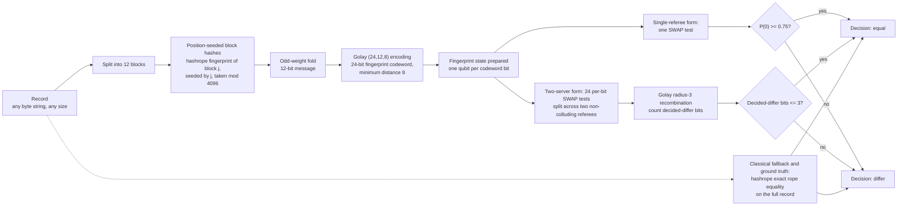

# qhashrope

A combined pack-and-verify prototype that joins two published classical systems with their quantum counterparts, built for the Qiskit Fall Fest 2026 hackathon at Florida Tech.

| Stage | Classical (published systems) | Quantum counterpart |
|---|---|---|
| Pack | MultiSpecQR: 3 payloads multiplexed into one RGB image | Superdense coding: 2 bits per transmitted qubit over shared Bell pairs |
| Verify | hashrope polynomial fingerprints (exact rope equality) | Ablayev-Vasiliev-style product-state fingerprints + SWAP test |

Both classical packages (multispecqr and hashrope, by the same author) are used unmodified. Full methods, environment, and analysis: [RESULTS.md](RESULTS.md).

## How the shared pipeline works

Every use case in `use cases/` runs the same pipeline; only the record and the parties change.



The pack side of the prototype is separate from this verify pipeline: classical MultiSpecQR multiplexing, or superdense coding at 2 bits per transmitted qubit over pre-shared Bell pairs (see `use cases/superdense-packing/`).

## Results (simulator, 2026-11-07; encoding and noise fixes 2026-11-08)

- Classical pack: 3 payloads into one 33x33 RGB image, decoded 3/3 exact.
- Quantum pack: superdense coding, 20 trials of 8-bit messages, accuracy 1.00; holds at 1.00 under depolarizing noise p=0.01 and p=0.05.
- Verification over 18 sequence pairs: classical hashrope 18/18, quantum fingerprint 18/18.
- End to end under noise p=0.02 (original encoding): classical 1.00, quantum 0.89 with one false positive, after calibrating the decision threshold from a known-identical pair under the same noise.
- Encoding fix (2026-11-08): position-seeded block hashing plus an Ablayev-Vasiliev Golay (24,12,8) fingerprint encoding with one global 0.75 threshold. Test suite 8/8, quantum verify 18/18 noiseless, chemistry pairs 5/5. With this encoding the monolithic SWAP test fails on identical pairs at p=0.02 (0.72-0.74 vs the 0.75 threshold); a two-server-style decomposition into per-bit SWAP tests with Golay-radius decision recombination classifies 13/13 pairs correctly at the same noise level in simulation. Details and caveats: [RESULTS.md](RESULTS.md), [TWO_SERVER_NOISE_FIX.md](TWO_SERVER_NOISE_FIX.md).

Status: simulator only. A hardware run on a real IBM Quantum backend is the remaining step.

## Run it

```
python tests/test_prototype.py   # 5 assertions
python run_prototype.py          # stages 1-6, writes results.json
```

Environment used for the recorded run: Python 3.12, Qiskit 2.6.2, qiskit-aer 0.18.2, multispecqr, hashrope. Raw outputs are in `logs/`, `results.json`, and `packed_rgb.png`.

## License

MIT
