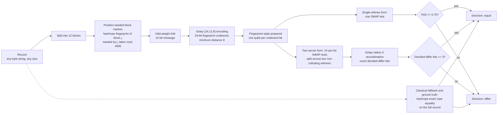

# qhashrope

**Exact equality testing of large records with O(log n) qubits exchanged.** Each party fingerprints its record locally and only the fingerprint travels: position-seeded hashrope block hashes are folded to a 12-bit message and expanded with the Golay (24,12,8) error-correcting code, so two fingerprints have overlap exactly 1 when the records' messages agree and exactly 0 otherwise, decided at one global threshold of 0.75 fixed in advance. Data movement uses superdense packing at 2 bits per transmitted qubit over pre-shared Bell pairs. For noisy settings, verification decomposes into 24 per-bit SWAP tests split across two non-colluding referees, with decisions recombined under the Golay radius-3 decoding rule; that two-server per-bit form, not the monolithic circuit, is the one that survives noise, in simulation and on IBM Quantum hardware.

This repository is the research artifact for that construction: the implementation, the measured failures that shaped it, and the fixes, with raw outputs. It was built for the Qiskit Fall Fest 2026 hackathon at Florida Tech and is the basis for planned research papers. The classical components are the author's published packages, hashrope and multispecqr, used unmodified.

## In plain terms

Two sites hold a large record and want one bit: identical, or not, without sending the record. qhashrope fingerprints each record (12 block hashes from hashrope, folded to a 12-bit message, expanded by the Golay (24,12,8) code into a 24-qubit fingerprint), packs classical data with superdense coding at 2 bits per transmitted qubit, and compares fingerprints with SWAP tests. The first encoding let distinct molecules collide: benzene and cyclohexane produced identical fingerprints. The error-corrected encoding removed that failure class, because any two distinct fingerprints now differ in at least 8 of 24 positions. Under device noise the single 24-qubit test degrades to the random floor, so verification is split into 24 per-bit tests whose binary decisions are recombined with the Golay decoding rule. That protocol went 13/13 in simulation at p = 0.02 and 3/3 with zero bit errors on ibm_marrakesh, where the monolithic test read 0.4814 on an identical pair. The current fingerprint is a basis state, so it carries no quantum communication advantage yet; the phase fingerprint is the route to one (see Limitations).

## Results

All numbers below are measured; the files behind each row are linked at the end of the table.

| Setting | Result |
|---|---|
| Verification, noiseless (Aer MPS, 4096 shots per test) | Quantum fingerprint 18/18 sequence pairs and 5/5 chemistry pairs at the single global threshold 0.75; classical hashrope 18/18 and 5/5 (exact reference) |
| Pack (superdense coding, 20 trials of 8-bit messages) | Accuracy 1.00 noiseless and under depolarizing noise p=0.01 and p=0.05; classical MultiSpecQR pack 3/3 exact |
| Monolithic 49-qubit SWAP test, depolarizing p=0.02 (simulation) | Fails identical pairs: measured P(0) of 0.7102 to 0.7634 across runs, straddling the 0.75 threshold; distinct pairs stay correct at 0.49 to 0.51 |
| Analog product recombination of the per-bit tests, p=0.02 (simulation) | Also fails: identical pairs at 0.5863 to 0.5927. Splitting the circuit is not by itself the fix |
| Two-server per-bit decisions with Golay radius-3 recombination, p=0.02 (simulation) | 13/13 pairs correct; zero bit-decision errors in 312 bit tests; identical pairs at 0 decided-differ bits, distinct pairs at 8 to 16 (their true Hamming distances) |
| Two-server per-bit protocol on IBM Quantum hardware (ibm_marrakesh, SamplerV2, 4096 shots per circuit) | 3/3 pairs correct; zero bit-decision errors in 72 bit tests |
| Monolithic 49-qubit SWAP test on the same hardware (exploratory, identical pair) | P(0) = 0.4814, decided differ: incorrect. The monolithic form fails on hardware as it does in simulation |

Detail and raw data: [RESULTS.md](RESULTS.md), [TWO_SERVER_NOISE_FIX.md](TWO_SERVER_NOISE_FIX.md), [HARDWARE_RESULTS.md](HARDWARE_RESULTS.md), [IBM_QUANTUM_RUN.md](IBM_QUANTUM_RUN.md), `results.json`, `two_server_results.json`, `hardware_results.json`, `logs/`.

## How it got here: two failures and two fixes

**Failure 1: the original encoding could not tell two molecules apart.** The first fingerprint used unseeded per-block polynomial hashes reduced mod 16, angle-encoded with no error-correcting code and therefore no guaranteed minimum distance. On chemistry records it failed twice. Benzene (`c1ccccc1`) and cyclohexane (`C1CCCCC1`) produced byte-identical 12-symbol codewords and scored P(0) = 1.0000, a false "equal" that no threshold can fix. Aspirin versus its one-character amide analog scored P(0) = 0.9839 against an analytic 0.9810, also a false "equal": the pair differed in one codeword symbol by one step, leaving the fingerprint overlap at cos²(π/16) in that coordinate.

**Fix 1: error-corrected fingerprints (Ablayev-Vasiliev form).** Block hashes are now mixed with their block index (splitmix64 finalizer) and reduced mod 4096, so sparse blocks of short strings no longer coincide systematically. The 12 block symbols are folded into one 12-bit message with odd weights, so any single-symbol change and any length change provably changes the message. The message is expanded with the extended binary Golay code (24,12,8), minimum distance 8 verified exhaustively over all 4096 codewords, and each encoded bit is prepared as an orthogonal basis state. Distinct messages therefore have fingerprint overlap exactly 0 and identical records exactly 1, and the decision threshold is the midpoint 0.75, set by construction and used for every pair in every run, with no per-pair or per-noise-level calibration anywhere in the pipeline. Noiseless results after the fix: test suite 8/8, quantum verify 18/18, chemistry 5/5.

**Failure 2: the monolithic circuit is fragile under noise.** At depolarizing p=0.02 the 49-qubit SWAP network contracts the identical-pair signal to the 0.7102 to 0.7634 band, on both sides of the 0.75 threshold from run to run, while distinct pairs stay correct. Recombining the split per-bit circuits as an analog product fails the same way (identical pairs at 0.5863 to 0.5927): each bit's contraction factor of about 0.93 compounds across all 24 factors. Decomposition alone fixes nothing.

**Fix 2: decisions, not analog values, recombined under the code.** Each of the 24 bit positions gets its own 3-qubit SWAP test (at most 5 noisy gates) and its own binary decision against the per-bit 0.75 threshold, where an agreeing bit sits about 0.2 above the floor-side values against shot noise of about 0.0078 at 4096 shots. The client then applies the Golay decoding rule: equal iff at most 3 of 24 bits are decided differ, the unique-decoding radius of the (24,12,8) code, so up to 3 fully wrong bit decisions cannot flip the answer. The architectural pattern, many small partial computations whose results the client recombines exactly, is imported from the author's ICTAI 2026 two-server additive secret sharing paper (see below); in the two-server mapping, two non-colluding referees each execute a disjoint subset of the bit tests. Simulation at p=0.02: 13/13. On ibm_marrakesh: 3/3, with per-bit P(0) tracking the simulation (agreeing bits 0.9456 to 0.9670, differing bits 0.4880 to 0.5334) despite the readout error, decoherence, and crosstalk the simulation model does not have.

## Architecture

| Stage | Classical (published systems) | Quantum counterpart |
|---|---|---|
| Pack | MultiSpecQR: 3 payloads multiplexed into one RGB image | Superdense coding: 2 bits per transmitted qubit over shared Bell pairs |
| Verify | hashrope polynomial fingerprints (exact rope equality) | Golay-encoded quantum fingerprints + SWAP test, single-referee or two-server per-bit |

Every use case in `use cases/` runs the same verify pipeline; only the record and the parties change.



The pack side is separate from this verify pipeline: classical MultiSpecQR multiplexing, or superdense coding at 2 bits per transmitted qubit over pre-shared Bell pairs (see `use cases/superdense-packing/`).

## Use cases

Fourteen applications, one folder each under [`use cases/`](use%20cases/), all reducing to the same question: are these two records equal, where the record is large or sensitive and the comparison happens under a communication or disclosure constraint. Every folder has a runnable `demo.py` (run-verified 2026-11-08), a case-specific "How it works" diagram, measured results, and a stated classical baseline boundary. Index with a comparative summary: [`use cases/README.md`](use%20cases/README.md).

- [genomic-identity-verification](use%20cases/genomic-identity-verification/) (12/12)
- [molecular-identity](use%20cases/molecular-identity/) (5/5, including the two pairs the original encoding failed)
- [compound-library-dedup](use%20cases/compound-library-dedup/) (64/64 cross pairs; exactly the 4 planted duplicates recovered)
- [superdense-packing](use%20cases/superdense-packing/) (round trips exact; pack accuracy 1.00 at p = 0, 0.01, 0.05)
- [model-dataset-integrity](use%20cases/model-dataset-integrity/), [replica-equality](use%20cases/replica-equality/), [record-linkage](use%20cases/record-linkage/), [quantum-chemistry-result-verification](use%20cases/quantum-chemistry-result-verification/) (3/3 each)
- [reaction-protocol-verification](use%20cases/reaction-protocol-verification/), [reference-standard-verification](use%20cases/reference-standard-verification/), [formulation-identity](use%20cases/formulation-identity/), [cell-line-authentication](use%20cases/cell-line-authentication/), [reference-build-verification](use%20cases/reference-build-verification/), [outbreak-strain-matching](use%20cases/outbreak-strain-matching/) (3/3 each, plus the two-server check under p=0.02 noise in each)

## Relation to published work

- **hashrope** (author's package, PyPI): the classical stage. Polynomial fingerprints over ropes give the exact equality check used as ground truth throughout, and the per-block fingerprint source for the quantum encoding. Used unmodified.
- **multispecqr** (author's package, PyPI): the classical pack stage, multiplexing payloads into one RGB image. Used unmodified.
- **Two-server pattern**: "Exact Privacy-Preserving Similarity Search via Two-Server Additive Secret Sharing," Syed, Alsulami, Silaghi, IEEE ICTAI 2026, DOI 10.1109/ICTAI70596.2026.00211; implementation at github.com/jemsbhai/herpb. The transfer is architectural (decompose into small partial computations, recombine exactly at the client), not a port of the secret-sharing arithmetic; [TWO_SERVER_NOISE_FIX.md](TWO_SERVER_NOISE_FIX.md) states the mapping and its limits.

## Limitations

These are stated plainly because they bound every claim above.

- **Fold collision.** Two distinct strings whose folded 12-bit messages collide, probability 2^-12 for a random distinct pair, are indistinguishable to the quantum stage in every variant, monolithic or decomposed, simulated or on hardware. The classical hashrope stage is the exact check and remains the backstop.
- **The direct two-party case is already solved classically.** Two parties who can exchange a classical hash and trust a single comparer get exact equality at negligible cost, and nothing here improves on that. The construction addresses the constrained regime: each party sends only a short fingerprint to a referee (or two), the parties share no randomness, and the equality bit is the only disclosure. In that simultaneous-message regime classical fingerprints need on the order of sqrt(n) bits against O(log n) qubits.
- **No speedup on one machine.** Preparing and comparing the fingerprint states costs more than comparing classical hashes. The claim is a communication statement, not a runtime one.
- **The monolithic circuit is not noise-robust.** At simulated p=0.02 its identical-pair estimates straddle the threshold from run to run, and on hardware it measured 0.4814 on an identical pair. Only the per-bit decision form is noise-resilient, at the measured noise levels.
- **Per-bit cost.** The two-server form runs 24 circuits per comparison instead of 1, and 24 times the shots for the same per-factor precision. On queued hardware, submission count dominates latency.
- **Simulation model gaps.** The Aer noise model used here is gate-depolarizing only: no readout error, no T1/T2 decoherence, no crosstalk. The hardware numbers include those effects but cover one device, one calibration cycle, and 3 pairs; they do not establish a scaling claim.
- **Dedup at library scale.** The 2^-12 fold probability would manufacture false duplicates in bulk across a large library, and candidate generation (eliminating the obviously different pairs before any equality test) is not implemented. The dedup folder is a protocol demonstration at 8 by 8, not a scale claim, and says so in its own README.
- **Scale of the demonstration.** 96 bp segments, short canonical records, 8-bit superdense payloads: a mechanism with measured numbers, not a benchmark against production tools.
- **Equality is over bytes.** Records must be canonicalized to identical serializations before fingerprinting; canonicalization is a classical preprocessing step and is out of scope here.

## Run it

```
python tests/test_prototype.py   # 5 assertions
python run_prototype.py          # stages 1-6, writes results.json
python two_server_experiment.py  # the p=0.02 head-to-head in TWO_SERVER_NOISE_FIX.md
```

Each use-case folder runs standalone with `python demo.py` from inside the folder.

Environment used for the recorded runs: Python 3.12, Qiskit 2.6.2, qiskit-aer 0.18.2, multispecqr, hashrope. Raw outputs are in `logs/`, `results.json`, and `packed_rgb.png`.

## License

MIT
