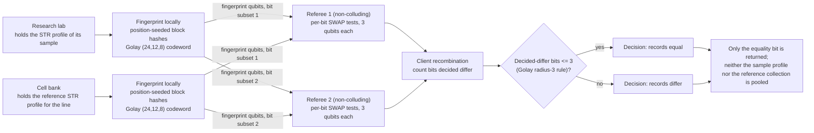

# Cell line authentication

**Problem.** Misidentified and cross-contaminated cell lines are a documented reproducibility problem in biomedical research: widely used lines have been shown to be something other than what papers claim (the classic case is HeLa contamination of other cultures), registries of misidentified lines run to hundreds of entries, and journals and funders increasingly require authentication. The standard check is an STR (short tandem repeat) profile compared against a reference profile. The comparison is an equality question over a small record, but it has to be run by every lab, against references held by cell banks, for lines whose provenance can itself be commercially or clinically sensitive.

**qhashrope fit.** The profile record (the standard marker panel with its allele calls) is fingerprinted by the lab for its sample and by the bank for the reference. A SWAP test answers whether the sample profile is the reference profile. The lab does not ship its sample's profile to a central service, and the bank does not distribute its reference collection; the only output is the match bit the authentication decision needs.

**Prototype status.** Measured in this folder: `cellline_demo.py` ran both verifiers on three profile pairs in the usual published STR format (noiseless MPS simulator, 4096 shots per pair, global threshold 0.75; full output in `results.json`). Classical hashrope 3/3, quantum fingerprint 3/3, including a one-allele difference at a single marker. The identical pair was also run under depolarizing noise p = 0.02 in both circuit forms; see below.

**Known limitation.** Real authentication is not exact equality. STR profiles drift in culture, mixed cultures produce extra alleles, and the field's working criterion is a high percentage match (commonly 80 percent) rather than identity, because a drifted but genuine line should still authenticate. The exact-equality core demonstrated here answers the strict question; a usable version needs a thresholded similarity protocol, which is a different and harder construction than fingerprint equality. Profiles are also records about the sample as typed, not about the cells: a swapped sample with correct paperwork passes.

## Measured results (fixed encoding, 2026-11-08)

Demo: `cellline_demo.py`; data: `results.json`. Settings: noiseless
AerSimulator (matrix_product_state), 4096 shots per pair, global threshold
0.75, Golay-encoded fingerprint.

| Case | Quantum P(0) | Decision |
|---|---|---|
| sample profile identical to the reference profile | 1.0000 | equal |
| one marker differing by one allele (TH01 9.3 to 8) | 0.5032 | differ |
| a different cell line's profile (HEK293) | 0.4963 | differ |

Classical hashrope agrees on all three pairs (3/3); quantum 3/3. The
single-allele change is a two-character edit in one marker field; its
codewords differ in 12 of 24 positions.

Two-server variant, identical pair, depolarizing noise p = 0.02:
monolithic P(0) = 0.7634, called equal this run; per-bit P(0) values in
[0.9546, 0.9744], 0 bits decided differ, Golay radius-3 decision equal.
As in the other folders, the monolithic identical-pair value at this
noise level is a run-dependent borderline quantity; the per-bit
decisions are not.

## How it works



## Run output

Run `python demo.py` from this folder with the project venv. It prints a per-pair verdict table; the verified summary line from the 2026-11-08 run is:

```
two-server (identical pair, p=0.02): monolithic P(0)=0.7527, decided-differ bits=0/24, verdict=equal (PASS)
SUMMARY: 3/3 pairs PASS (classical 3/3, quantum 3/3)
```
