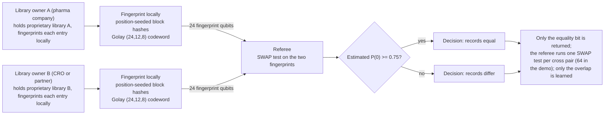

# Compound library deduplication without disclosure

**Problem.** Two organizations each hold a proprietary compound library: a pharma company and a CRO, two merger partners, a vendor and a screening center. Both would benefit from knowing the overlap (duplicates to merge, shared compounds to link to existing assay data), and neither can pool the structures: the library itself is the trade secret, and even a list of canonical SMILES is a disclosure of research direction.

**qhashrope fit.** Library overlap, at its core, is a batch of equality questions, and equality is the one answer a fingerprint comparison can give without giving anything else. Each side fingerprints its own canonical strings locally; a SWAP test per candidate pair returns same or different and reveals almost nothing about either structure, not even its length class beyond the fingerprint size. The classical hashrope check is the exact reference implementation of the same protocol for settings where a classical exchange is acceptable.

**Prototype status.** The verify stage this case rests on is demonstrated end to end in simulation, and the chemistry-specific run in the molecular-identity folder is the honest calibration for expectations: on five SMILES pairs the quantum stage classified 3 of 5 correctly, including a full codeword collision between two distinct short structures. A library-scale version additionally needs a candidate-generation step (most cross-library pairs are obviously different and never need a SWAP test), which this prototype does not yet have.

**Known limitation.** Equality-only cuts both ways: the protocol answers "identical canonical string" and nothing more, so tautomers, salt forms, and alternate canonicalizations of the same compound read as different unless both sides canonicalize identically first, and near-duplicates (the analog series a chemist actually cares about) are out of scope by construction. The measured collision risk in the molecular-identity demo also applies directly: with the current codeword, some distinct short structures are indistinguishable to the quantum stage, so a dedup run today would silently merge them. The error-correcting codeword upgrade is a prerequisite for trusting the quantum stage at library scale; the classical stage has no such issue. (Update, 2026-11-08: that upgrade has landed; the prototype status above describes the pre-fix encoding, and the measured results with the fixed encoding follow below.)

## Measured results (fixed encoding, 2026-11-08)

Demo: `dedup_demo.py`; data: `results.json` (full 8x8 match matrix).
Settings: noiseless AerSimulator (matrix_product_state), 4096 shots per
pair, global threshold 0.75, Golay-encoded fingerprint. 64 cross-library
pairs compared.

- Planted duplicates across the libraries: aspirin, benzene, caffeine,
  ethanol (4).
- Quantum fingerprint matches: exactly those 4, each at P(0) = 1.0000.
  No extras, no misses.
- Classical hashrope reference: the same 4, agreeing exactly.

## Strengthened analysis, 2026-11-08

**Scale.** In-house screening collections at large pharmaceutical
companies are on the order of a million compounds; commercial
make-on-demand catalogs run to tens of billions of enumerated
structures. A naive all-pairs overlap check between two million-scale
libraries is on the order of 10^12 pair questions, which is why the
measured 8x8 demo is a protocol demonstration and not a scale claim:
at production scale almost all pairs must be eliminated by a
candidate-generation stage (grouping by molecular formula or scaffold
class, both of which are themselves disclosures to be budgeted) before
any equality test, classical or quantum, is run. The per-question cost
is 24 qubits and one bit of output; the number of questions is the
engineering problem.

**Protocol mapping.** The fingerprinted string is each library entry's
canonical structure string, computed locally by its owner and never
exchanged. Party A and Party B are the two library owners. For each
candidate pair, the owners send their fingerprints to a referee whose
SWAP test returns same or different; neither owner learns anything
about the other's non-matching entries beyond what the pattern of
answers itself reveals (the overlap set is the intended output, and it
is revealed to whoever runs the recombination, which must be a party
both owners accept learning it). In the two-server variant, the 24
per-bit tests for each candidate pair are split across two
non-colluding referees and recombined by the Golay radius-3 rule.
Measured at root level under depolarizing noise p = 0.02: 13/13
correct, zero bit-decision errors in 312 tests, identical pairs at 0
decided-differ bits, distinct at 8 to 16, where the monolithic circuit
failed every identical pair. Under noise, that decision rule is the
difference between a dedup run that silently drops true duplicates
(the monolithic identical-pair failures read as "different") and one
that keeps them.

**Classical baseline boundary.** If both owners are willing to reveal
classical hashes of their canonical strings to a common comparer, the
overlap computation is a sort-and-join over hash lists: exact, fast,
and fully classical, and this case should not be claimed otherwise.
What the hash list reveals, however, is every entry's hash, which
supports dictionary attacks against known compound collections and
leaks library size and composition statistics. The quantum setting
adds value exactly where that disclosure is the obstacle: a referee
(or two) who learns only per-pair equality answers, in the
simultaneous-message model with no shared randomness. Dedup between
two divisions of one company does not need it; dedup between
competitors or merger parties under antitrust counsel might.

**Next steps.** (1) Candidate generation with an explicit disclosure
budget: which grouping keys (formula, scaffold class) each side is
willing to reveal, since grouping is what makes 10^12 pairs tractable.
(2) Fold size: at library scale the 2^-12 per-pair fold-collision
probability is disqualifying on its own (it would manufacture false
duplicates in bulk); a production version needs a wider message or
multiple independent fingerprints per entry, with the quantum stage
acting as a filter and the classical hashrope stage confirming the
survivors exactly. (3) Canonicalization agreement covering tautomers
and salt forms, which decide more real dedup outcomes than the
equality primitive does. (4) A batch two-server run under noise at
hundreds of pairs, to measure the decision rule's behaviour as a
filter rather than on single pairs.

## How it works



## Run output

Run `python demo.py` from this folder with the project venv. It prints a per-pair verdict table; the verified summary line from the 2026-11-08 run is:

```
SUMMARY: 64/64 cross pairs PASS (classical 64/64, quantum 64/64), match set exact: True
```
