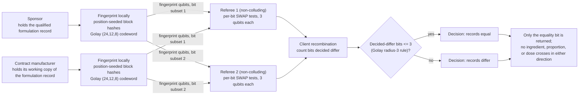

# Formulation identity verification

**Problem.** A sponsor company qualifies a formulation, then a contract manufacturer produces it. The manufacturer has to work to the qualified recipe, and the sponsor has to be able to confirm that the recipe on the production floor is the qualified one. The formulation itself is a trade secret: the sponsor does not want the full composition circulating beyond need, and the manufacturer does not want to hand its working copy back for inspection either. What both sides actually need is one bit: same formulation, or not.

**qhashrope fit.** The formulation record (product, active ingredient and dose, excipients with proportions, specification identifier) is fingerprinted locally on each side. A SWAP test returns equality and nothing else: no proportions, no ingredient list, no dose crosses in either direction. It is the equality-only shape of the problem stated exactly, which is why this case is in the folder: the disclosure constraint is the whole requirement, not an added feature.

**Prototype status.** Measured in this folder: `formulation_demo.py` ran both verifiers on three formulation-record pairs (noiseless MPS simulator, 4096 shots per pair, global threshold 0.75; full output in `results.json`). Classical hashrope 3/3, quantum fingerprint 3/3, including a single proportion change of one percentage point in one excipient. The identical pair was also run under depolarizing noise p = 0.02 in both circuit forms; see below.

**Known limitation.** Equality is over the record, at the precision the record states. A proportion written as 5 mg on one side and 5.0 mg on the other, or rounded differently, reads as a different formulation, so both sides must serialize to the same canonical record, and the record's stated precision defines what "same" means. The protocol also says nothing about whether production followed the record; it verifies the recipe text, not the batch.

## Measured results (fixed encoding, 2026-11-08)

Demo: `formulation_demo.py`; data: `results.json`. Settings: noiseless
AerSimulator (matrix_product_state), 4096 shots per pair, global threshold
0.75, Golay-encoded fingerprint.

| Case | Quantum P(0) | Decision |
|---|---|---|
| identical formulation, sponsor vs contract manufacturer | 1.0000 | equal |
| one component proportion changed (Mg-stearate 5mg to 6mg) | 0.4937 | differ |
| a different formulation (suspension product) | 0.4900 | differ |

Classical hashrope agrees on all three pairs (3/3); quantum 3/3. The
proportion change is a one-character edit; its codewords differ in 8 of
24 positions, the Golay minimum distance, and the pair reads at the
analytic floor.

Two-server variant, identical pair, depolarizing noise p = 0.02:
monolithic P(0) = 0.7502, essentially on the 0.75 threshold and called
equal this run; per-bit P(0) values in [0.9570, 0.9790], 0 bits decided
differ, Golay radius-3 decision equal. A monolithic estimate that lands
on the threshold to the fourth decimal is the clearest illustration in
this folder set of why the decision-level recombination exists: the
per-bit decisions have a wide margin where the single global estimate
has none.

## How it works



## Run output

Run `python demo.py` from this folder with the project venv. It prints a per-pair verdict table; the verified summary line from the 2026-11-08 run is:

```
two-server (identical pair, p=0.02): monolithic P(0)=0.7600, decided-differ bits=0/24, verdict=equal (PASS)
SUMMARY: 3/3 pairs PASS (classical 3/3, quantum 3/3)
```
