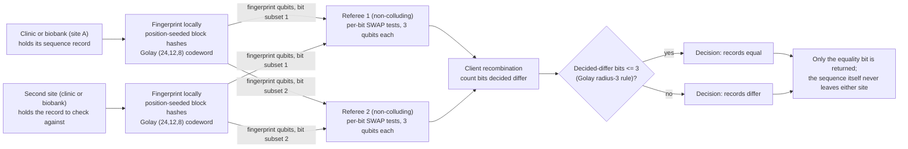

# Private genomic identity verification

**Problem.** Two sites hold sequence data and need to know whether the records are the same: a clinic confirming a sample matches the one a central lab sequenced, or two biobanks checking whether they hold the same donor. Sending the sequence itself is a privacy exposure and, at genome scale, a large transfer.

**qhashrope fit.** Each side computes a quantum fingerprint of its sequence locally and sends only the fingerprint: O(log n) qubits for an n-base record. A SWAP test answers equality and reveals almost nothing about the sequence itself. This is the quantum counterpart of hashrope-bio, the author's classical genomic toolkit validated on GRCh38 chr22 (5,770/5,770 gene/exon queries) and ClinVar (3,422/3,422 pathogenic SNVs localized).

**Prototype status.** The verification stage is demonstrated on seeded 96 bp segments: identical, 1, 3, and 10 substitution pairs separate cleanly in simulation (SWAP-test P(0) of 1.000, 0.625, 0.573, 0.503). Scaling to full-length sequences and a hardware run are open steps.

**Known limitation.** The current block-hash codeword has no minimum distance, so near-identical sequences sit close to the decision threshold (one false positive under depolarizing noise p=0.02). The Ablayev-Vasiliev error-correcting encoding is the planned fix.

## Measured results (fixed encoding, 2026-11-08)

Demo: `genomic_demo.py`; data: `results.json`. Settings: noiseless
AerSimulator (matrix_product_state), 4096 shots per pair, global threshold
0.75. Fingerprint: 12 position-seeded block symbols (mod 4096) folded to a
12-bit message, extended Golay (24,12,8) encoding, SWAP test.

| Pair class (3 pairs each) | Quantum P(0) estimates | Decision |
|---|---|---|
| identical | 1.0000, 1.0000, 1.0000 | equal |
| 1 substitution | 0.5007, 0.4912, 0.4951 | differ |
| 3 substitutions | 0.5083, 0.5029, 0.4944 | differ |
| 10 substitutions | 0.4980, 0.4954, 0.5034 | differ |

Accuracy: classical hashrope 12/12, quantum fingerprint 12/12. Distinct
pairs sit at the analytic floor 0.5 regardless of substitution count,
because any message difference flips at least 8 of the 24 encoded bits.

## Strengthened analysis, 2026-11-08

**Scale.** A human genome is about 3.2 billion bases. One 30x
whole-genome run produces raw instrument output on the order of 100 GB,
and even the aligned, compressed form is tens of GB per donor. Reference
collections operate at matching scale: public variant archives hold
millions of submitted variant records, and population biobanks hold
sequence data for hundreds of thousands of donors. Any identity check
that moves the sequence itself moves gigabytes per question; the
fingerprint moves 24 qubits per question, independent of record size.
That asymmetry, not raw speed, is the quantified form of the problem.

**Protocol mapping.** The fingerprinted string is the canonical
sequence record under comparison (in the demo, a 96 bp segment; in
deployment, the agreed locus or record serialization). Party A is the
holding site (clinic or biobank) with its copy; Party B is the second
site with the record it wants to check against. In the single-referee
form, both send their 24-qubit fingerprints to a referee, who runs the
SWAP test and returns one bit. In the two-server variant, the 24 per-bit
SWAP tests are split across two non-colluding referees (each runs a
disjoint subset of the 3-qubit tests), the referees return per-bit
estimates, and the client recombines them by the Golay radius-3 rule:
equal iff at most 3 of 24 bits are decided differ. Measured at root
level under depolarizing noise p = 0.02 (RESULTS.md, two-server
section): 13/13 pairs correct with zero bit-decision errors in 312 bit
tests, identical pairs at 0 decided-differ bits and distinct pairs at
8 to 16, where the monolithic circuit failed all 5 identical pairs
(0.7244 to 0.7402 against the 0.75 threshold). Neither referee sees a
sequence, a hash of a sequence, or the other party's record; each sees
only fingerprint qubits for its assigned bit positions.

**Classical baseline boundary.** If the two sites may exchange a
classical hash over an authenticated channel and both accept a plain
comparison, a classical hash (or the hashrope check itself, which is
exact) solves this problem completely, at negligible cost, today. The
quantum construction earns its place only in the constrained setting:
the simultaneous-message model, where each party may send only a short
fingerprint to a referee and the parties share no randomness (there,
classical fingerprints need on the order of sqrt(n) bits against
O(log n) qubits), and where the disclosure budget is the equality bit
and nothing else. Outside that setting this case is a communication
result applied to genomics, not a claim that the quantum check is the
cheaper tool.

**Next steps.** (1) Longer records: the current fold compresses any
input to a 12-bit message, so chromosome-scale records need a blocked
multi-fingerprint form with a fold-collision probability sized to the
number of comparisons, not 2^-12. (2) Canonicalization of variant
representations before fingerprinting (the same variant has several
valid serializations; equality is over bytes). (3) The two-server
variant on hardware: the per-bit circuits are 3 qubits and shallow, so
they are the natural first hardware target. (4) A defined referee
non-collusion arrangement for the clinic and biobank setting, since the
privacy reading depends on it.

## How it works



## Run output

Run `python demo.py` from this folder with the project venv. It prints a per-pair verdict table; the verified summary line from the 2026-11-08 run is:

```
SUMMARY: 12/12 pairs PASS (classical 12/12, quantum 12/12)
```
