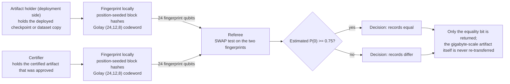

# Model and dataset integrity attestation

**Problem.** A deployed model or a copied dataset is only trustworthy if it is bit-identical to the artifact that was evaluated and approved. The artifacts are gigabytes, so re-transferring or re-hashing them across organizations for every check is slow, and a hash alone does not bind the check to a governed approval process.

**qhashrope fit.** The holder of the deployed artifact and the holder of the certified artifact each produce a quantum fingerprint; a SWAP test attests equality with a message logarithmic in the artifact size. Combined with governed execution (budgeted, approval-gated, exactly replayable agent runs, as in the author's Pollard system), the check becomes part of an auditable chain: the artifact attested is the artifact approved is the artifact executed.

**Prototype status.** The verify primitive is demonstrated on byte-string payloads in simulation (18/18 sequence pairs classified correctly; 0.89 end-to-end accuracy under depolarizing noise p=0.02 after noise-calibrated thresholding). Applying it to real checkpoint files is an integration step, not a research step.

**Known limitation.** Near-identical artifacts (a checkpoint differing in a few weights) sit near the decision threshold with the current encoding; the error-correcting fingerprint encoding is the planned fix.

## Measured results (fixed encoding, 2026-11-08)

Demo: `integrity_demo.py`; data: `results.json`. Settings: noiseless
AerSimulator (matrix_product_state), 4096 shots per pair, global threshold
0.75, Golay-encoded fingerprint as in the root RESULTS.md (2026-11-08
section). Payload: synthetic checkpoint record strings (~3.2 KB).

| Case | Bytes differing | Quantum P(0) | Decision |
|---|---|---|---|
| record vs itself | 0 | 1.0000 | equal |
| copy with 3 bytes changed | 3 | 0.5073 | differ |
| a different checkpoint | 2,720 | 0.4985 | differ |

Classical hashrope agrees on all three pairs (3/3); quantum 3/3.

## How it works



## Run output

Run `python demo.py` from this folder with the project venv. It prints a per-pair verdict table; the verified summary line from the 2026-11-08 run is:

```
SUMMARY: 3/3 pairs PASS (classical 3/3, quantum 3/3)
```
