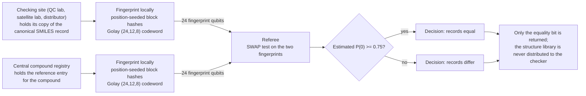

# Molecular identity verification

**Problem.** A compound record has to be confirmed identical across sites without shipping the underlying structure library around: a manufacturing site checking a batch's compound record against the reference entry during QC, a satellite lab verifying a sample against the central registry, a distributor confirming the substance in a shipment is the registered one. The record itself is a canonical structure string (SMILES, InChI), and in QC and reference-library settings the full library is often licensed, export-controlled, or simply too large to distribute to every checker.

**qhashrope fit.** Each side holds its own copy of the canonical string and computes the fingerprint locally. Only the O(log n) qubit fingerprint travels; a SWAP test answers "same compound record or not" and exposes nothing else about the structure. The classical hashrope check runs alongside as the exact ground truth: where the two agree, the answer is certain; the quantum stage is the privacy- and bandwidth-shaped version of the same question.

**Prototype status.** Measured, not projected: `chem_demo.py` in this folder ran both verifiers on five canonical SMILES pairs (noiseless MPS simulator, 4096 shots per SWAP test, decision threshold P(0) >= 0.85; full output in `results.json`). The classical hashrope check was correct on all 5 pairs. The quantum stage was correct on 3 of 5:

| Pair | Classical | Codeword Hamming | SWAP-test P(0), measured (analytic) | Quantum verdict |
|---|---|---|---|---|
| aspirin vs aspirin, `CC(=O)Oc1ccccc1C(=O)O` | equal | 0 | 1.0000 (1.0000) | equal, correct |
| aspirin vs its amide analog, terminal O to N, one character | differ | 1 | 0.9839 (0.9810) | equal, **false positive** |
| benzene `c1ccccc1` vs toluene `Cc1ccccc1` | differ | 6 | 0.5071 (0.5228) | differ, correct |
| benzene vs pyridine `c1ccncc1`, one ring atom C to N | differ | 1 | 0.6465 (0.6543) | differ, correct |
| benzene vs cyclohexane `C1CCCCC1` | differ | 0 | 1.0000 (1.0000) | equal, **false positive** |

Estimated P(0) tracked the closed-form analytic value on every pair (largest deviation 0.0157, within shot noise at 4096 shots), so the simulator is not the problem; the encoding is. Two distinct failure modes showed up. The amide analog differs in exactly one codeword symbol, by one step (14 to 13), which leaves the fingerprint overlap at cos^2(pi/16) in that coordinate and P(0) far above any usable threshold: a threshold problem. Benzene and cyclohexane are worse: their 12-symbol codewords are completely identical (Hamming 0). Both strings are 8 characters, so most of the 12 blocks hold zero or one character, and the mod-16 residues of the one-character block hashes coincide for every block: a collision no threshold can fix. The middle pair is the instructive success: pyridine also differs from benzene in one block, but by a large symbol step (4 to 15), and P(0) drops to 0.6465. Hamming distance alone does not set the overlap; symbol step size does.

**Known limitation.** As measured above, the block-hash codeword has no guaranteed minimum distance, and short canonical strings are the worst case for it: many empty or one-character blocks, and a mod-16 alphabet too coarse to separate chemically distinct tokens. For compound records the fix is the same Ablayev-Vasiliev upgrade named in the main results (an error-correcting code over the symbols before the angle encoding), plus chemistry-aware blocking so that a block boundary never isolates a single character. Until then, the honest division of labor is: classical hashrope for the verdict, quantum fingerprint as the research prototype for the settings where only a fingerprint may travel.

## Fixed encoding: re-run, 2026-11-08

The Ablayev-Vasiliev upgrade named above has landed (same day). The
fingerprint encoding in `qhashrope/quantum_verify.py` changed in three
ways: (1) block hashing is seeded with the block index and uses a
4096-symbol alphabet instead of unseeded mod-16 residues, so sparse blocks
of short strings no longer coincide systematically; (2) the 12 block
symbols are folded (odd weights, so any single-symbol change provably
changes the result) into a 12-bit message, which is expanded through the
extended Golay (24,12,8) code before state preparation, so any two
distinct messages differ in at least 8 of 24 encoded positions and have
exactly zero fingerprint overlap; (3) the decision threshold is a single
global 0.75, the midpoint of the analytic interval [0.5, 1.0] implied by
that bound, used for every pair. The pre-fix encoding remains available
behind a `legacy` flag for reproducibility.

Re-running `chem_demo.py` under the fixed encoding (same simulator, same
4096 shots, threshold 0.75; full output in `results.json`):

| Pair | Classical | Encoded Hamming | SWAP-test P(0), measured (analytic) | Quantum verdict |
|---|---|---|---|---|
| aspirin vs aspirin | equal | 0 | 1.0000 (1.0000) | equal, correct |
| aspirin vs its amide analog, one character | differ | 12 | 0.4944 (0.5000) | differ, correct |
| benzene vs toluene | differ | 12 | 0.4849 (0.5000) | differ, correct |
| benzene vs pyridine, one ring atom | differ | 12 | 0.4900 (0.5000) | differ, correct |
| benzene vs cyclohexane | differ | 12 | 0.4980 (0.5000) | differ, correct |

Quantum stage: 5/5, classical 5/5. Both original failure modes are closed
by construction, not by threshold choice: the benzene/cyclohexane
codewords are no longer identical (their messages differ, and the encoded
words differ in 12 positions), and the one-character amide change now
moves the pair to the analytic floor 0.5 instead of 0.9839, because a
one-symbol change cannot produce a nearby codeword under a distance-8
code.

Remaining limitations, unchanged or new: inputs must still be canonical,
byte-identical strings (canonicalization stays a classical preprocessing
step); two different strings whose folded messages collide (probability
2^-12 for a random distinct pair) remain indistinguishable to the
fingerprint, the standard fingerprint caveat; and these are simulator
numbers, not hardware numbers.

## Strengthened analysis, 2026-11-08

**Scale.** The record is small and the library is not. A canonical
SMILES string is tens of bytes; an InChI runs to a few hundred. The
libraries those records index are the large objects: public collections
hold over 100 million compound records (PubChem) and over 2 million
curated bioactive compounds (ChEMBL), and regulatory inventories list
tens of thousands of registered industrial substances. A QC or registry
check is one record against one reference entry, repeated at every site
that handles the substance, against libraries that are licensed,
export-controlled, or too large to mirror everywhere. The cost being
avoided is distributing and trusting copies of the library, not
comparing the strings, which is why the protocol is shaped around
sending a 24-qubit fingerprint of the one record instead.

**Protocol mapping.** The fingerprinted string is the canonical
structure string for the compound (SMILES in the demo; InChI is the
other natural choice, and the choice must be fixed per registry). Party
A is the checking site (QC lab, satellite lab, distributor) holding its
record for the batch or sample; Party B is the registry or reference
holder with the master record. In the single-referee form both send
fingerprints to a referee whose SWAP test returns the one bit. In the
two-server variant, two non-colluding referees each run a disjoint
subset of the 24 per-bit SWAP tests and return per-bit estimates; the
client applies the Golay radius-3 rule (equal iff at most 3 bits
decided differ). Measured at root level under depolarizing noise
p = 0.02: 13/13 correct, zero bit-decision errors in 312 tests,
identical pairs at 0 decided-differ bits, distinct pairs at 8 to 16,
against a monolithic circuit that failed all 5 identical pairs
(0.7244 to 0.7402 vs threshold 0.75). The aspirin and benzene pairs in
this folder were part of that 13-pair set and classified correctly in
both circuit forms' decision rules that matter here: noiseless
monolithic 5/5, two-server per-bit 13/13 overall.

**Classical baseline boundary.** Plainly: for a single check between
two sites that can talk to each other, comparing classical hashes of
the canonical strings solves this completely and exactly, and the
hashrope stage in this folder is that solution. The fingerprint
protocol adds something only where the setting forbids the plain
solution: a referee who must decide without either side revealing its
record to the other or to the referee beyond the equality bit, in the
simultaneous-message model with no shared randomness (the regime where
the classical fingerprint lower bound is on the order of sqrt(n) bits
and the quantum one is O(log n) qubits). A registry that is happy to
receive hashes does not need this; a registry whose records may not be
exposed to the checkers, and checkers whose holdings may not be exposed
to the registry, is the setting the construction addresses.

**Next steps.** (1) Fix the canonicalization contract per registry:
tautomer and salt handling decided before fingerprinting, since the
protocol compares bytes. (2) Batch mode for registry-scale checking
(many records per site), which raises the same candidate-generation
question as the dedup case when both sides hold sets. (3) Widen the
message fold for production use; 2^-12 per-pair collision probability
is a demo parameter, not a registry parameter. (4) Hardware run of the
per-bit two-server form, whose 3-qubit circuits are the realistic
near-term target.

## How it works



## Run output

Run `python demo.py` from this folder with the project venv. It prints a per-pair verdict table; the verified summary line from the 2026-11-08 run is:

```
SUMMARY: 5/5 pairs PASS (classical 5/5, quantum 5/5)
```
