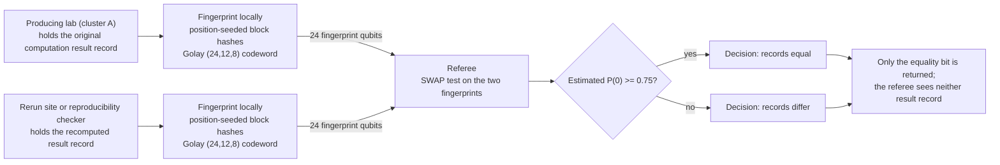

# Quantum chemistry result verification

**Problem.** Computational chemistry results get recomputed constantly: an optimized geometry or checkpoint produced on one cluster is rerun on another machine, in another lab, or by a collaborator validating a published result. The outputs are large records (geometries, wavefunction checkpoints, property blocks), and "did we get the same answer?" is usually answered by eyeballing a few printed energies, which misses silent divergence in the parts nobody printed.

**qhashrope fit.** Treat the result record as what it is for verification purposes: a byte string. Fingerprint the canonicalized output on each side and compare with a SWAP test; the O(log n) qubit fingerprint stands in for a record of any size, and the classical hashrope fingerprint of the same record is the exact check beside it. This is the replica-equality case specialized to scientific computing, with one domain-specific twist: it verifies that two quantum computations agree, using a quantum communication primitive to do it.

**Prototype status.** The verification pipeline is demonstrated in simulation on string payloads, including a chemistry run on canonical SMILES in the molecular-identity folder (classical stage exact on all pairs; quantum stage correct on 3 of 5, with a measured codeword collision that bounds what the current encoding can be trusted to distinguish). No quantum-chemistry output files have been run through it yet; the record-canonicalization step that real checkpoint and log formats need does not exist in this prototype. (Update, 2026-11-08: the collision and the 3-of-5 result belong to the pre-fix encoding; under the fixed encoding the molecular-identity pairs measure 5 of 5, and this folder's own measured results follow below.)

**Known limitation.** Byte equality is stricter than scientific equivalence. Two runs of the same calculation routinely differ in byte-level details that mean nothing (iteration counts, ordering of printed terms, floating-point last digits across architectures), so a raw fingerprint check flags agreement-level results as different; and genuinely different results that happen to share a codeword would pass. A usable version needs a canonicalization layer that reduces a result record to its scientifically meaningful content before fingerprinting, which is a chemistry judgment, not a hashing detail. The exact-equality core demonstrated here is the foundation that layer would sit on.

## Measured results (fixed encoding, 2026-11-08)

Demo: `qchem_demo.py`; data: `results.json`. Settings: noiseless
AerSimulator (matrix_product_state), 4096 shots per pair, global threshold
0.75, Golay-encoded fingerprint.

| Case | Quantum P(0) | Decision |
|---|---|---|
| same result record from two machines | 1.0000 | equal |
| one coordinate changed in the third decimal | 0.5068 | differ |
| a different geometry (methane record) | 0.5083 | differ |

Classical hashrope agrees on all three pairs (3/3); quantum 3/3. The
third-decimal change is a single character in one block; under the fixed
encoding that suffices to move the pair to the analytic floor 0.5 (under
the pre-fix encoding, the analogous one-character change in the aspirin
pair scored 0.9839; see molecular-identity).

## Strengthened analysis, 2026-11-08

**Scale.** The record sizes span orders of magnitude depending on what
counts as the result. A log-file summary block (method, energy,
geometry) is kilobytes, as in the demo. A formatted checkpoint with
density and wavefunction data for a mid-size molecule in a triple-zeta
basis is megabytes to gigabytes; integral and wavefunction files for
large-basis correlated calculations reach tens of gigabytes. The
verification question is asked at cluster scale: the same job rerun on
a second machine, a collaborator's cluster, or a different code
version, where shipping the full artifact for a byte comparison is the
cost the fingerprint avoids (24 qubits, independent of artifact size).

**Protocol mapping.** The fingerprinted string is the canonicalized
result record: in the demo, the method header plus geometry block; in
deployment, whatever serialization the canonicalization layer (below)
reduces the artifact to. Party A is the producer of the original
result; Party B is the rerun site (a second cluster, a collaborator, a
reproducibility service). Both fingerprint locally; a referee's SWAP
test returns the equality bit. Neither side transfers the artifact, and
the referee sees neither artifact, only fingerprints. In the
two-server variant the 24 per-bit tests split across two non-colluding
referees with Golay radius-3 recombination by the client. Measured at
root level under depolarizing noise p = 0.02: 13/13 correct, zero
bit-decision errors in 312 tests, identical pairs at 0 decided-differ
bits and distinct at 8 to 16, against monolithic identical-pair
failures at 0.7244 to 0.7402. For this case the noise point is not
academic: a rerun-verification service is exactly the setting where
the checker may be a noisy near-term device, and a checker that calls
identical results different (the monolithic failure mode) is worse
than no checker.

**Classical baseline boundary.** Between two clusters that can
exchange files or hashes freely, this is a solved classical problem:
hash the canonicalized record on both sides and compare, exactly, with
the hashrope stage as that solution. The quantum construction is for
the narrower setting where the artifact itself is export-controlled,
proprietary, or simply too large to move for a check, and the parties
share no randomness and delegate the decision to a referee who may
learn only the equality bit: the simultaneous-message regime where
classical fingerprinting costs on the order of sqrt(n) bits against
O(log n) qubits. Most in-house rerun checking does not live in that
regime and should use hashes; cross-institution verification of
restricted calculations is the honest target.

**Next steps.** (1) The canonicalization layer is the real work:
reduce a result record to its scientifically meaningful content
(sorted geometry at stated precision, final energies at stated
rounding, method and basis identifiers) so that byte equality tracks
scientific agreement instead of formatting. This is a chemistry
judgment per code and per artifact type, and it decides whether the
protocol is usable at all. (2) Ingestion of real checkpoint formats
rather than hand-written records. (3) A precision policy: the
third-decimal coordinate change in the demo reads as different, which
is correct for exact equality; a deployment must state the rounding at
which two results count as the same result, in the record format
itself. (4) Hardware run of the per-bit two-server form.

## How it works



## Run output

Run `python demo.py` from this folder with the project venv. It prints a per-pair verdict table; the verified summary line from the 2026-11-08 run is:

```
SUMMARY: 3/3 pairs PASS (classical 3/3, quantum 3/3)
```
