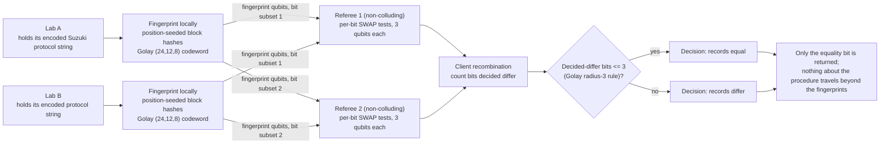

# Reaction protocol verification

**Problem.** Two labs about to compare results first have to know they ran the same experiment. Most irreproducibility disputes in synthetic chemistry are protocol divergences in disguise: a different addition order, a 5 degree temperature offset, a swapped base or catalyst loading, each enough to change a yield and none of them visible in a results table. The check usually happens informally, by emailing procedures around, and it happens after the discrepancy, not before.

**qhashrope fit.** Encode the protocol once, as a canonical string covering reagents, stoichiometry, solvent, conditions, and order of addition. Each lab fingerprints its encoded copy locally; a SWAP test answers whether the two encodings are identical, and nothing else about the procedure travels. Run before the experiment, it is cheap provenance: the equality bit is the precondition for comparing outcomes at all.

**Prototype status.** Measured in this folder: `reaction_demo.py` ran both verifiers on three protocol-string pairs (noiseless MPS simulator, 4096 shots per pair, global threshold 0.75; full output in `results.json`). Classical hashrope 3/3, quantum fingerprint 3/3. The identical pair was also run under depolarizing noise p = 0.02: the monolithic circuit measured 0.7385 and failed the 0.75 threshold, while the two-server per-bit decomposition decided 0 of 24 bits differ and called it equal under the Golay radius-3 rule. See the measured results section below.

**Known limitation.** Equality is over the encoding, not over the bench. Two labs can hold byte-identical protocol strings and still diverge in practice (addition rate, vessel geometry, reagent lot), and two encodings of the same procedure written by different chemists differ as strings until a canonical protocol format is agreed. The fingerprint verifies that the agreed text matches; it cannot verify that the text was followed.

## Measured results (fixed encoding, 2026-11-08)

Demo: `reaction_demo.py`; data: `results.json`. Settings: noiseless
AerSimulator (matrix_product_state), 4096 shots per pair, global threshold
0.75, Golay-encoded fingerprint.

| Case | Quantum P(0) | Decision |
|---|---|---|
| identical protocol held by two labs | 1.0000 | equal |
| one condition changed (temperature 80C to 85C) | 0.5017 | differ |
| a different reaction (Heck protocol) | 0.4995 | differ |

Classical hashrope agrees on all three pairs (3/3); quantum 3/3. The
temperature change is a two-character edit in one field; the encoded
codewords differ in 16 of 24 positions, so the pair sits at the analytic
floor 0.5, as any distinct pair does under the fixed encoding.

Two-server variant, identical pair, depolarizing noise p = 0.02
(same noise model as the root RESULTS.md): monolithic P(0) = 0.7385,
called differ (wrong); per-bit P(0) values in [0.9570, 0.9739], 0 bits
decided differ, Golay radius-3 decision equal (correct). This is the
pattern measured at root level in RESULTS.md: at p = 0.02 the
monolithic identical-pair signal contracts below threshold, and the
per-bit decision recombination is what survives.

## How it works



## Run output

Run `python demo.py` from this folder with the project venv. It prints a per-pair verdict table; the verified summary line from the 2026-11-08 run is:

```
two-server (identical pair, p=0.02): monolithic P(0)=0.7383, decided-differ bits=0/24, verdict=equal (PASS)
SUMMARY: 3/3 pairs PASS (classical 3/3, quantum 3/3)
```
