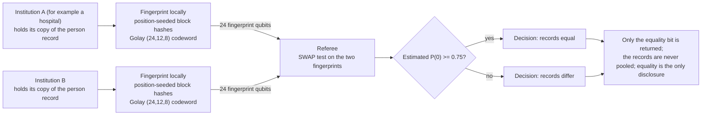

# Record linkage without disclosure

**Problem.** Two institutions, for example two hospitals, need to deduplicate or link records: is this the same patient on both sides? Privacy law and policy forbid pooling the records to find out, and most linkage questions are really equality questions about one record at a time.

**qhashrope fit.** Each institution fingerprints its copy of the record locally. The SWAP test outputs one bit, same or different, and the fingerprints reveal almost nothing else about the record. Equality is the only disclosure, which is exactly the constraint health and administrative data impose.

**Prototype status.** The equality primitive is demonstrated in simulation (18/18 pairs; separation gradient measured from identical down to 10 substitutions). A realistic record schema and field-level encoding are the next steps.

**Known limitation.** Exact equality is brittle for records with formatting differences (name spellings, date formats). A production version needs a canonicalization step before fingerprinting, and near-duplicate detection is a different, harder problem than the equality case demonstrated here.

## Measured results (fixed encoding, 2026-11-08)

Demo: `linkage_demo.py`; data: `results.json`. Settings: noiseless
AerSimulator (matrix_product_state), 4096 shots per pair, global threshold
0.75, Golay-encoded fingerprint. All records are fictional.

| Case | Quantum P(0) | Decision |
|---|---|---|
| same record on both sides | 1.0000 | equal |
| one field differs by one character (DOB day) | 0.4919 | differ |
| a different person | 0.4993 | differ |

Classical hashrope agrees on all three pairs (3/3); quantum 3/3.

## How it works



## Run output

Run `python demo.py` from this folder with the project venv. It prints a per-pair verdict table; the verified summary line from the 2026-11-08 run is:

```
SUMMARY: 3/3 pairs PASS (classical 3/3, quantum 3/3)
```
