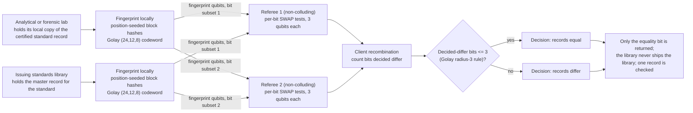

# Reference standard verification

**Problem.** Analytical and forensic work is only as good as its reference standards: a lab identifies or quantifies a substance against a certified reference record issued by a standards library. The lab's local copy of that record has to be the library's record, not a stale, mistyped, or substituted one. Distributing the full reference library to every checking lab is often not an option: libraries are licensed, some records are controlled, and a forensic reference collection is itself sensitive.

**qhashrope fit.** The record under check is a canonical substance record: name, registry numbers, formula, canonical structure string, lot, certified assay. The lab fingerprints its copy locally; the issuing library fingerprints the master record; a SWAP test answers whether they are the same record. The library never ships the library, and the check exposes nothing beyond the one equality answer about the one record.

**Prototype status.** Measured in this folder: `refstd_demo.py` ran both verifiers on three record pairs (noiseless MPS simulator, 4096 shots per pair, global threshold 0.75; full output in `results.json`). Classical hashrope 3/3, quantum fingerprint 3/3. The identical pair was also run under depolarizing noise p = 0.02 in both circuit forms; see the measured results section below for both numbers, reported as measured.

**Known limitation.** The check binds a record, not a physical material. A matching record does not prove the vial on the bench contains what the record says, and a degraded or adulterated standard passes this test as long as its paperwork matches; physical assay remains necessary. Record-level, the usual caveat applies: both sides must serialize the record identically (field order, rounding of the certified assay) or the same standard reads as different.

## Measured results (fixed encoding, 2026-11-08)

Demo: `refstd_demo.py`; data: `results.json`. Settings: noiseless
AerSimulator (matrix_product_state), 4096 shots per pair, global threshold
0.75, Golay-encoded fingerprint.

| Case | Quantum P(0) | Decision |
|---|---|---|
| identical standard record, lab vs issuing library | 1.0000 | equal |
| one field differing (certified assay 99.8 to 99.7) | 0.5010 | differ |
| a different substance (theobromine record) | 0.4790 | differ |

Classical hashrope agrees on all three pairs (3/3); quantum 3/3. The
one-field change (a single character in the assay value) moves the pair
to the analytic floor. The theobromine estimate, 0.4790, is the farthest
below the 0.5 floor of any pair in this folder, about 2.7 sampling
deviations at 4096 shots; the decision is unaffected, since the
threshold sits at 0.75.

Two-server variant, identical pair, depolarizing noise p = 0.02:
monolithic P(0) = 0.7576, called equal this run; per-bit P(0) values in
[0.9541, 0.9763], 0 bits decided differ, Golay radius-3 decision equal.
The monolithic identical-pair estimate at p = 0.02 is a borderline
quantity (the root RESULTS.md records repeated measurements between
0.7102 and 0.7634 across this folder set and the root runs), straddling
the 0.75 threshold from run to run; the per-bit decision is the stable
one.

## How it works



## Run output

Run `python demo.py` from this folder with the project venv. It prints a per-pair verdict table; the verified summary line from the 2026-11-08 run is:

```
two-server (identical pair, p=0.02): monolithic P(0)=0.7461, decided-differ bits=0/24, verdict=equal (PASS)
SUMMARY: 3/3 pairs PASS (classical 3/3, quantum 3/3)
```
