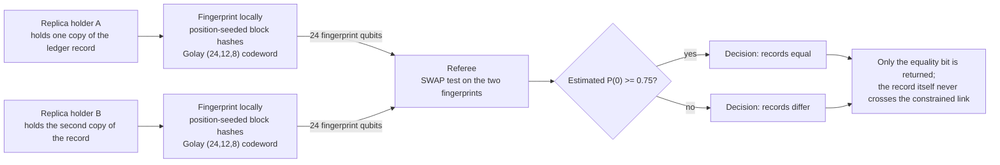

# Replica equality over constrained links

**Problem.** Distributed systems hold copies that must agree: database replicas, ledger copies, backup archives. Verifying that two large copies are still identical usually means transferring the data or trusting one side's word.

**qhashrope fit.** Quantum fingerprinting is one of the few proven exponential separations in communication complexity. In the simultaneous-message model, two parties each send a referee an O(log n) qubit fingerprint of an n-bit string, against O(sqrt(n)) classical bits for the same task without shared randomness. The referee's SWAP test decides equality. Nothing else about the data is communicated.

**Prototype status.** Demonstrated in simulation on 96 bp segment fingerprints (18/18 pairs correct, with a measured separation gradient from identical to 10 substitutions). This folder's case is the theory anchor for the whole project: the claim to state precisely, including the model it holds in.

**Known limitation.** The separation is a communication result, not a claim that today's hardware beats a classical hash for a single direct comparison. The honest boundary: two parties, a referee, no shared randomness, and privacy of the underlying string.

## Measured results (fixed encoding, 2026-11-08)

Demo: `replica_demo.py`; data: `results.json`. Settings: noiseless
AerSimulator (matrix_product_state), 4096 shots per pair, global threshold
0.75, Golay-encoded fingerprint. Record: 3,420-byte ledger string.

| Case | Quantum P(0) | Decision |
|---|---|---|
| replica vs itself | 1.0000 | equal |
| one byte changed at the end | 0.4902 | differ |
| one byte changed at the start | 0.5093 | differ |

Classical hashrope agrees on all three pairs (3/3); quantum 3/3. The
position of the differing byte does not matter: position-seeded block
hashing feeds the changed block into the message fold wherever it sits.

## How it works



## Run output

Run `python demo.py` from this folder with the project venv. It prints a per-pair verdict table; the verified summary line from the 2026-11-08 run is:

```
SUMMARY: 3/3 pairs PASS (classical 3/3, quantum 3/3)
```
