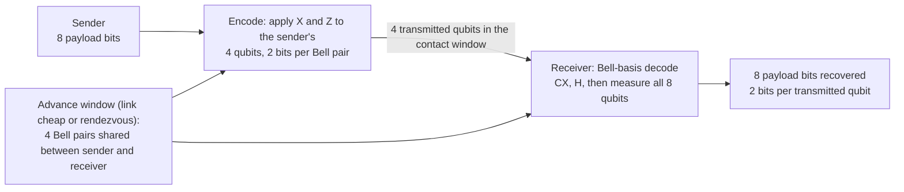

# Entanglement-assisted dense packing

**Problem.** Some links are intermittent or expensive: a satellite in a short contact window, a probe with scheduled passes. Bandwidth during the pass is the scarce resource, and classical density tricks (as in MultiSpecQR's color multiplexing) do not transfer to qubits; the Holevo bound caps one qubit at one classical bit when it is read.

**qhashrope fit.** Superdense coding is the exception: with Bell pairs shared in advance, during a low-traffic window or a physical rendezvous, each transmitted qubit later carries 2 classical bits. The pack stage of this prototype demonstrates exactly that: 8 payload bits over 4 transmitted qubits.

**Prototype status.** Demonstrated in simulation: 20 trials of 8-bit messages, accuracy 1.00, holding at 1.00 under depolarizing noise p=0.01 and p=0.05. This is the most forward-looking case in the folder; entanglement distribution and storage at useful scales are open engineering problems, and the case is framed as a research direction, not a near-term product.

**Known limitation.** The 2x density is real but conditional on pre-shared entanglement surviving until the send window. Decoherence during storage is the binding constraint.

## Measured results (2026-11-08)

Demo: `packing_demo.py`; data: `results.json`. Settings: 20 trials per
condition, 8-bit payloads on 4 transmitted qubits (4 pre-shared Bell
pairs), 1024 shots per trial, AerSimulator with the stated noise model.

| Condition | Message accuracy | Bit accuracy |
|---|---|---|
| noiseless | 1.00 | 1.0000 |
| depolarizing p=0.01 | 1.00 | 1.0000 |
| depolarizing p=0.05 | 1.00 | 1.0000 |

The pack stage is unchanged by the 2026-11-08 fingerprint fix (the fix
concerns the verify stage); these are fresh runs of the same protocol
reported in the root RESULTS.md.

## How it works



## Run output

Run `python demo.py` from this folder with the project venv. It round-trips six 8-bit payloads and compares decoded bits with sent bits; the verified summary line from the 2026-11-08 run is:

```
SUMMARY: 6/6 payloads round-tripped exactly (48/48 bits)
```
